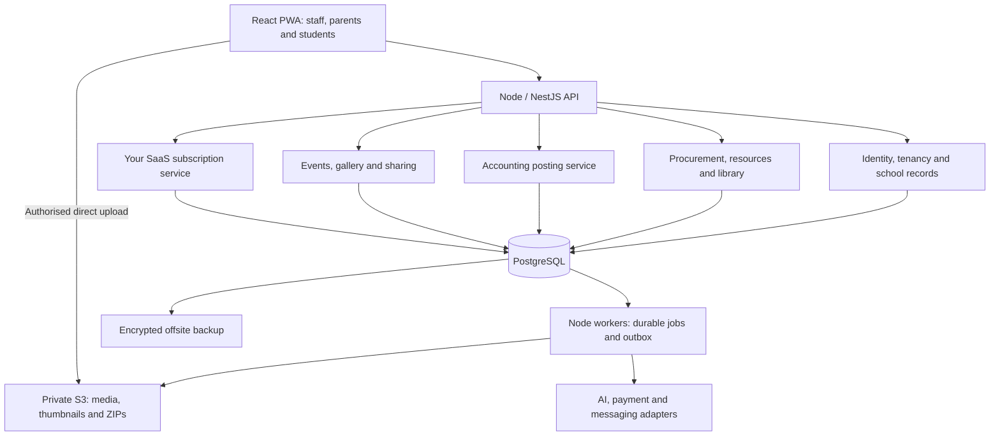

# Integrated school SaaS: inventory, library, accounting and event galleries

Revised 21 October 2026. Requirements confirmed in this chat: India only; React frontend; preferred Node.js backend; subscription business; full procurement and accounting; library integrated with inventory; event/date galleries; parent download packages shared through expiring message links; tenant and role access; platform school onboarding/billing and administrator setup; and a publishable public school website with enquiry capture. Cheapest practical infrastructure before revenue remains a constraint.

This revision takes precedence over the initial narrow-MVP blueprint. There is no implemented school application in this workspace yet; the files are research, architecture and cost-planning artifacts.

## Recommended stack and the scope change

Use **React + Vite + TypeScript** for the frontend, **Node.js + TypeScript + NestJS with its Fastify adapter** for the backend, and **PostgreSQL**. Start as a modular monolith. Use a separate Node worker process from the same repository, with pg-boss initially. Use an established authentication implementation, schema validation, database migrations and private object storage. React's static build can be served independently of the API. [Vite deployment](https://vite.dev/guide/static-deploy.html), [NestJS Fastify support](https://docs.nestjs.com/techniques/performance), [pg-boss](https://github.com/timgit/pg-boss).

This respects your language preference. ERPNext is valuable as a reference implementation and an optional financial integration; it is not a required runtime. A complete custom accounting engine materially increases engineering and verification effort compared with a fee ledger. Compare a custom build against adaptation before committing the full budget, but do not choose a Python application solely because it was suggested earlier.

If you later adopt ERPNext, its own stack and database must be operated separately and verified against the chosen versions. Do not assume Frappe's framework-level PostgreSQL support establishes ERPNext compatibility. Frappe sites use their own databases; this differs from the proposed shared PostgreSQL tenant model. [Official deployment guidance](https://github.com/frappe/helm/blob/main/erpnext/README.md), [Frappe site model](https://docs.frappe.io/framework/user/en/basics/sites).

## Existing systems: documented capabilities and what to investigate

These observations come from official documentation and product pages, not a hands-on audit. “Not verified” does not mean “not supported.” No vendor was contacted and no private quote was obtained.

- **Fedena:** inventory pages document requisitions, suppliers, stores, purchase orders, invoices and goods-received notes. Library pages describe barcode circulation, renewals, fines and exports. Basic inventory/library functionality is established competition. Verify receipt-to-accession linkage and accounting reconciliation in a demo. [Inventory](https://fedena.com/feature-tour/school-inventory-management-system), [library](https://fedena.com/feature-tour/library-management-system).
- **Entab:** published library releases include barcode printing and stock verification; its library overview describes reservations, overdue notices and fee-ledger linkage. Its campus store offering covers purchases, stock and parent ordering. Barcode support or library fines are not novel propositions. Test rejected deliveries, book-copy identity, cancellation and payment allocation. [Library releases](https://www.entab.in/entab-release-library.html), [library overview](https://www.entab.in/entab-blog-library.html), [campus store](https://www.entab.in/tuck-shop-management-system.html).
- **MyClassboard:** documents library categories, vendors, languages, fines, barcode generation, loan durations and student-profile integration; its suite also lists inventory. Investigate exact posting and cross-module controls rather than claiming it lacks integration. [Library](https://www.myclassboard.com/erp/library-management-system-software/), [suite](https://www.myclassboard.com/explore-all-products/).
- **Teachmint:** an official 2023 ERP overview describes facilities inventory and library catalog/circulation. This older overview establishes advertised scope, not current availability in every plan. Obtain a current demonstration and quote. [ERP modules overview](https://blog.teachmint.com/what-are-the-school-erp-modules/).
- **ERPNext + Frappe Education:** strong reference for procurement, accounting, stock and school records. Purchase receipts distinguish accepted/rejected locations; purchase invoices can reference receipts; corrections preserve ledger history. Education fee documentation describes invoice linkage. School-specific library circulation and a polished parent experience still need fit assessment. [Purchase receipt](https://docs.frappe.io/erpnext/purchase-receipt), [purchase invoice](https://docs.frappe.io/erpnext/purchase-invoice), [immutable ledger](https://docs.frappe.io/erpnext/immutable-ledger-in-erpnext), [Education fees](https://docs.frappe.io/education/fees).
- **Koha:** specialised library reference for bibliographic records versus copies, acquisitions, circulation, reservations and stocktaking. Its manual describes scanner-based inventory and offline circulation utilities, so offline/library stocktaking also cannot be claimed as unique. A Koha integration adds a second operational system and API reconciliation work. [Cataloguing and inventory](https://koha-community.org/manual/latest/en/html/cataloging.html), [circulation](https://koha-community.org/manual/latest/en/html/circulation.html), [API](https://api.koha-community.org/).
- **Snipe-IT:** useful reference for asset assignment, custody/history, audits, QR labels and imports. It is not by itself a full school library or financial ERP. Avoid adding it merely to obtain asset labels when your own resource engine already owns those records. [Official features](https://snipeitapp.com/product).

The opportunity is a measurable improvement in school workflows: migration quality, fewer duplicate entries, clear exception handling, financial traceability, parent convenience and affordable operation. Whether schools perceive these as unmet needs must be validated locally.

## One resource foundation, with distinct business rules

Share vendors, purchasing, locations, approvals, identifiers and audit history. Keep three resource types:

1. **Consumables:** notebooks, paper, cleaning supplies and consumable lab materials. Track units, receipts, issues, returns and quantities.
2. **Equipment/assets:** computers, projectors and instruments. Track each relevant unit's tag/serial, location, custodian, condition, warranty and financial classification.
3. **Library material:** title/edition metadata and individual physical copies. Each copy has an accession number, barcode, acquisition source and circulation history.

A title is not a copy. Twenty books with one ISBN require twenty copy identifiers. ISBN identifies a publication/edition, and some materials have no ISBN. School-issued accession/barcode identifies the physical copy.

Ownership, location, condition and availability should be separate fields or derived states. A book can be school-owned, with a student, physically worn and on loan at the same time. A withdrawn copy must not reappear as available because someone scanned it during stock verification.

**Borrowing changes custody, not ownership.** A library loan should not automatically create a stock expense, sale, supplier invoice or depreciation event. An equipment assignment should follow the same principle.

## Procurement, stock and accounting workflow

Recommended school flow:

```text
Department request → budget check → approval → supplier quotations
→ purchase order → partial/full receipt and inspection
→ accepted stock / rejected stock → accession or asset tagging
→ supplier invoice match → authorised payment → bank reconciliation
```

Support donations and opening balances as explicit acquisition sources. Importing an opening library register should not manufacture a new supplier invoice or repost historical expenditure.

Record requested, ordered, delivered, accepted, rejected and billed quantities independently. A partial receipt leaves the rest of the order open. Supplier invoice matching checks quantity, price and approved tolerances against the order and accepted receipts. An exception should require review, not silently change the order. Define who may request, approve, receive, post invoices and approve payments. For very small schools, permit combined roles while retaining an auditable exception.

Return the correct quantity and cost basis to the supplier through a linked reversal/return, with the appropriate financial adjustment. Do not mark vendor payment complete merely because a checkout page returned success. Reconcile it to authoritative payment/bank evidence. Use approval controls for write-offs, unusual adjustments, vendor-bank-detail changes and closed-period corrections.

For “full accounting,” budget for chart of accounts, balanced journals, receivables/payables, cash/bank, allocation, advances, refunds, credit/debit notes, cost centres, budget commitments versus actual spending, assets/depreciation, reconciliation, period close, trial balance and financial reports. Schools using trust/society reporting may require income/expenditure presentation in addition to a conventional P&L. A school accountant must confirm the accounting basis and report formats. A fee balance screen is not a substitute for this scope. [Accounting reference](https://docs.frappe.io/erpnext/accounting-introduction), [budget reference](https://docs.frappe.io/erpnext/budget), [bank reconciliation](https://docs.frappe.io/erpnext/bank-reconciliation), [asset depreciation](https://docs.frappe.io/erpnext/asset-depreciation).

Design configurable India tax fields and accountant-approved mappings. GST input eligibility, TDS, invoicing/reporting obligations and applicability vary by institution and transaction; do not hardcode one universal education exemption or reclaim every tax amount. Software exports and reconciliation do not themselves constitute statutory filing.

### Worked transaction example

Illustration only: a school buys 100 identical books at ₹400 each, under an accountant-approved perpetual-inventory policy, with no tax or freight in this example.

- Approved order: ₹40,000 commitment; no journal solely from this illustrative order.
- Accepted receipt: 100 copies; debit inventory ₹40,000 and credit goods received/not billed ₹40,000.
- Matched supplier bill: clear the receipt accrual ₹40,000 and establish vendor payable ₹40,000.
- Vendor payment: clear payable and reduce bank by ₹40,000.
- One copy borrowed: 99 available and 100 owned; no GL entry from the loan.
- One copy formally written off as lost: reduce owned copies after approval and post its accountant-approved carrying-value adjustment. A fine/charge, if applicable, is a separate authorised recovery.

Different book capitalisation, expense, depreciation, tax and receipt-accrual policies change these postings. The operational book register remains useful even when books were expensed on purchase. Do not count expensed books again as financial inventory without an approved policy.

## Public school websites on the same platform

Each tenant also receives a school-branded public website. School creation seeds a draft from approved public onboarding fields and a shared template. The school admin completes details, previews and publishes; a separate deployment per school is unnecessary. Do not publish private billing contacts or school-owner login details by default. Initially serve `/schools/:slug/` with Home, About, Academics, Events and Contact/admission-enquiry pages. Optional subdomains and verified custom domains can follow; map only registered hosts to site records and configure TLS separately.

The website includes school name/logo, a prominent banner and approved campus image, introduction, curriculum/classes and verified facilities, public office contacts, curated event photos and an enquiry form. Use structured content and reusable layouts instead of arbitrary executable HTML or a separate CMS installation per school. Store reviewed English/Hindi content versions when offered; do not silently auto-translate unreviewed public claims. SEO titles, descriptions, canonical URLs, crawlable links and a published-page sitemap belong to this public layer.

Use `school_sites`, `site_drafts`, `site_revisions`, `site_pages`, `site_public_media`, optional `site_domains`, `admission_enquiries` and `enquiry_events`. The first website draft is provisioned idempotently with the tenant. The authenticated school-admin module saves drafts. Public routes read only the published content projection. A publish job validates tenant activation, publisher permissions, slug uniqueness, required school details and selected media approvals, renders a versioned HTML/public-data snapshot, then atomically updates the active revision. Draft edits and failed publish jobs leave the live revision unchanged. Record actor, revision and publication time; support republish, rollback and unpublish with cache invalidation.

Keep the private React/Vite portal and the Node public-website module in the existing repository and deployment. Render/prerender public HTML from the shared template using the existing Node worker, then cache it so normal visitors do not trigger the full school database workload. Public content changes when the school publishes a revision; enquiries remain dynamic API writes. This avoids a new application server, Redis instance or paid CMS for each school. Subscription/maintenance coverage for the website, custom domains and bespoke changes must be stated explicitly.

Public event marketing is a separate publication decision from parent-only gallery access. Generate approved, appropriately sized public derivatives without embedded location metadata. Do not expose original private object keys, expiring parent packages, unreleased papers, student records or enquiry contact details. Removing a published asset requires public-object/cache invalidation, but saved public images cannot be recalled. An unpublish request must stop future normal public serving; account for CDN and browser caching in the published-media policy.

The enquiry form collects minimal parent/guardian contact, class of interest and an optional question, with permission to contact about that enquiry. Do not ask for identity documents, sensitive student details or passwords on this public form. The server derives the school from its published route/site mapping, rather than trusting a posted tenant ID. Apply server validation, per-site/IP throttles, spam controls, payload limits and submission idempotency. Keep enquiry records private to authorised admissions staff. Follow-up states are New → Contacted → Visit booked → Applied → Closed, with actor/time history; conversion to an application requires the admissions workflow and duplicate checks.

Proposed interfaces: `GET /schools/:slug/:page`, `POST /schools/:slug/enquiries`, authenticated `GET/PUT /v1/website/draft`, `POST /v1/website/publish`, `POST /v1/website/unpublish`, and scoped `GET/PATCH /v1/admission-enquiries`. Public endpoints must never reuse an unrestricted internal student or tenant-admin API. Website creation does not make school management or parent portals public.

The HTML review now includes section 40, with page navigation, branding/content editor, explicit public-event approval, local publish/unpublish revisions, enquiry validation and a private follow-up inbox. Illustrations and school details are samples. No real school website is deployed by these controls.

## Backend boundaries

### Explicit tenant and user access contract

Every protected request follows: authenticated session → verified tenant membership → permission → class/child/resource scope → transaction-local database scope. Default to deny. React can hide unavailable actions, but Node and PostgreSQL remain authoritative.

- **Platform administrator:** tenant lifecycle, subscription billing and operational health. Detailed student, photo and school finance access is not automatic; use an explicit time-limited, audited support grant with the school's approved access policy.
- **School/tenant administrator:** full functional access to all modules, users and records within their own tenant. Cannot grant access to a different school. Accounting integrity, immutable audit history and configured review workflows still apply.
- **Teacher:** assigned academic years, classes/sections and subjects; permitted attendance, homework assignment, teaching content, marks and feedback. Students submit their homework work to the assigned activity. Teacher access does not extend to unrelated classes or subjects.
- **Accountant:** own-school financial records with separately assigned posting, approval, reconciliation and period-close rights.
- **Librarian/storekeeper:** permitted catalogue, circulation, stock/custody and receipt actions; not unrestricted student finance access.
- **Parent:** verified linked children and authorised event/form audiences.
- **Student:** own published learning records and permitted library/learning actions.

Never trust a URL, subdomain, browser-supplied tenant ID or cached frontend state as authorisation. Foreign keys must prevent mixed-tenant links. Use a non-owner database runtime role without BYPASSRLS; force row security as appropriate and set tenant context locally within each transaction. Tenant-scoped caches, private downloads, report exports, jobs and message recipient snapshots are part of the same boundary. Resolve webhook tenants from trusted stored provider/merchant mappings, not arbitrary payload identifiers.

Release tests must include Tenant A requesting Tenant B records by guessed IDs; forged tenant form fields; cross-tenant imports/exports/files/jobs; a parent requesting an unrelated child within the same school; a teacher editing an unassigned class; duplicate provider callbacks; expired support grants; and concurrent requests proving database connection context does not leak. The HTML review contains local expected-decision scenarios, not proof of implemented backend isolation.

### Bulk messaging, history and bilingual parent dashboard

School admins can broadcast to all verified parents within their tenant, or select an academic year, class/section, event audience or individual guardians. Teachers can message only their assigned audiences. Resolve recipients on the server, deduplicate guardian accounts, preview channel eligibility and estimated usage, then save the approved content and recipient snapshot. Deliver each message privately; other parents must not receive recipient contact lists. Use a durable outbox, scheduled jobs, idempotency and provider callback reconciliation.

Retain campaign history: author, approver, tenant scope, audience criteria, resolved recipient snapshot, subject/body and content version, language, scheduled/sent timestamps, channel, delivery attempts, failure codes, retry history and provider IDs. Distinguish published-in-portal, provider delivered/read, parent portal read and actual task completion. A correction creates another version and preserves the previous content. Message history and exports follow the same role/tenant rules; redact contact details where the viewer lacks permission. Define school retention and deletion policies rather than assuming infinite storage.

Provide English and Hindi interface dictionaries, using Unicode text and locale-aware dates and amounts. Parent account language preference and notice content language are separate. Store approved localized notice versions linked to one campaign; an AI-generated translation stays a draft until staff review it. Show an explicit fallback when a translation is unavailable. Provider template approval and channel eligibility are checked per content version/language; do not silently substitute an unapproved translation. Hindi and English require font and layout checks across phones and generated PDFs.

The parent dashboard offers a verified-child switcher, school notice inbox and read history, attendance, due homework, fees, published report cards, library returns, meetings, consent actions and approved galleries/packages. A notice may be whole-school or relevant to a linked child. Every backend query checks membership and guardian links; changing a child ID cannot grant access. Return aggregates from the authoritative modules. Parents cannot modify marks or fee balances. Read status is a receipt and does not count as consent or payment.

Proposed interfaces: `POST /v1/campaigns/preview`, `POST /v1/campaigns/:id/approve`, `GET /v1/campaigns`, `GET /v1/campaigns/:id/delivery`, `GET /v1/me/dashboard`, `GET /v1/me/notices`, `POST /v1/me/notices/:id/read`. Include `announcement_versions`, `announcement_translations`, `recipient_snapshots`, `delivery_attempts` and `announcement_reads` in the notification module.

### Student dashboard, profiles and filters

Expose a school-admin student directory with combined academic-year, class, section, admission-state, attendance-band and fee-state filters; name/admission search, deterministic sorting and bounded cursor pagination. Preserve filters when returning from a profile. Counts and filter options must come from the authorised scope, not reveal school-wide totals to restricted roles. A parent sees only verified children; a teacher sees assigned academic scopes, with financial or sensitive fields omitted unless separately authorised. Apply access scope before filter predicates and aggregates. Parameterise queries; allowlist filter/sort fields and index common tenant/year/class combinations after measuring queries. Do not fetch an entire school's profiles and filter them only in React.

Keep stable student identity separate from yearly enrolments and published result versions. Profile areas include overview, permitted guardians, attendance/homework, published results, library obligations, authorised fee records and change history. Do not return all confidential fields and merely hide tabs. Old academic years remain queryable under the same permission checks. Exports and background reports preserve the requested filter snapshot and access boundary.

### Platform school onboarding and commercial account

Provide a separate platform-admin console for customer school/legal details, billing contact and invoice identity, authorised school owner, school-admin invitation, private versioned contracts, negotiated plan terms, trial/effective/renewal dates, subscription fee and cadence, maintenance fee and cadence, optional setup fee, invoices, payments, credits and renewal history. A school customer can exist before its tenant is activated. Keep a billing account, tenant identity and user membership distinct. Track onboarding prerequisites explicitly: customer draft → commercial review → configured contract/acceptance evidence → owner invitation → idempotent tenant provisioning → trial/active state.

Maintenance is an explicit contractual charge, not a hidden percentage. Describe its coverage and check overlap with subscription support. Its schedule can differ from the subscription: for example, a monthly subscription and annual maintenance. One-time setup or maintenance charges do not recur. Itemise charges by their effective versions, use integer paise, preserve original invoice lines, and apply validated tax, credit and proration rules through the SaaS billing module. Usage charges remain separately metered. Define grace, cancellation and read-only/suspension behaviour before automatically restricting a school; avoid deleting records when an invoice is overdue.

For cheap initial deployment, keep this control plane as a separate module in the Node monolith, with explicit routes/guards and a restricted commercial-data database role. The platform billing runtime must not gain direct grants to school-owned student, academic, media or school-ledger tables; do not give it a blanket BYPASSRLS role. Commercial file access requires its own private S3 grants. School admins can view only their own authorised plan, agreement, invoices and payment status. Platform support access to student data continues to require the separate audited grant described above.

Provisioning retries must reuse a customer/activation idempotency key rather than create another tenant or school-admin membership. Audit contract versions, fee changes, activations, suspensions, invoice adjustments and reconciled payment events. These are your SaaS company's revenue records; student school fees and school purchase accounting remain separate ledgers.

### Creating the first school-admin login

The platform provisioning operator creates a tenant plus an individual first administrator, not one shared password for the school. Capture school code, administrator name, username and verified setup contact. Resolve `(tenant_id, normalized_username)` through `user_login_aliases` to a user and membership; enforce case-insensitive uniqueness within that school. A school code is a login locator, not authorisation. A matching email must not silently attach an existing user to a new school: the verified owner accepts the intended membership.

Prefer a setup invitation so the school admin chooses their password. Bind a cryptographically random, short-lived, single-use token to its user, intended recipient, school and setup purpose; store its hash and consumption/expiry state. Use 24 hours as an initial configurable invitation policy. Consume it atomically. Reissue invalidates the earlier setup credential. Expired, revoked, used or differently scoped tokens cannot activate a user. This adapts the token controls in the [OWASP recovery guidance](https://cheatsheetseries.owasp.org/cheatsheets/Forgot_Password_Cheat_Sheet.html).

If an initial temporary-password option is needed, generate it on the server, restrict delivery/reveal to the authorised onboarding operator, expire it, verify the intended owner's contact, and allow only password replacement until setup is complete. It must not unlock school data directly. Never retain plaintext passwords or include passwords/tokens in audit logs. Store salted adaptive password hashes, such as Argon2id, using a maintained authentication library and parameters tested against the deployment budget; [OWASP password-storage guidance](https://cheatsheetseries.owasp.org/cheatsheets/Password_Storage_Cheat_Sheet.html) provides the baseline. Rate-limit authentication and setup endpoints and use secure server-validated sessions.

After tenant provisioning, owner verification and password setup, activate the own-school administrator membership. Later, that administrator creates separately scoped staff accounts and parent invitations. Established-account recovery sends a fresh setup/reset link to the verified owner; platform staff cannot read the current password or silently choose a replacement for an active account. Revoke affected sessions during recovery. This process is separate from time-limited support access to school records.

Keep secret-free events for requesting operator, affected school/user, issue/reissue/expiry, verification, activation and session revocation. Release tests cover duplicate provisioning, case-colliding usernames, token reuse/expiry/reissue, changing the requested school, temporary credentials attempting normal APIs, and recovery of an existing account. The HTML contains a lifecycle demonstration only; it does not reserve usernames or create usable credentials.

### Academic scope, report cards and exam provenance

The resource hierarchy is tenant/school → academic year → class/section → subject → exam → student. All linked identifiers must belong to the same tenant and valid academic relationships. Permissions may be scoped by year, class, subject or individual child; a school admin has all own-tenant functional scopes, while teachers receive assigned scopes.

Provide student report cards, class/section result views and academic-year summaries. Subject teachers enter marks only for assigned subjects and exam classes. A designated class teacher or exam reviewer can review broader aggregates when explicitly assigned; parents/students see only their own published results. Use deterministic grade/weight rules, versioned reports and controlled PDF exports. Preserve absent/exempt states, correction reasons and the published version rather than silently rewriting results.

For each exam, record paper-setter assignment, author and paper version/hash; reviewer identity, decision, comments and reviewed version; approver and release/lock action; invigilator and actual conduct/session record; student candidates, attendance and individual attempts; marker and result-entry revisions; and report publisher. “Who conducted the exam” and “which student attempted it” are separate facts from who wrote the question paper.

Question-paper workflow: draft → submitted for review → changes requested/new version or approved → locked → securely released. Enforce configured independent review with distinct actors when required; any permitted school-admin override has a reason and audit event. Draft papers and answer keys remain private to authorised exam staff, with release windows and short-lived download access. Parents/students cannot fetch unreleased papers by guessing file or exam IDs.

Audit events retain actor, effective role/assignment, action, tenant/year/class/subject/exam scope, timestamp, source version and correction/approval reason. Ordinary school-admin access does not erase history. Do not put complete private paper/answer contents into routine logs. Apply the same permissions to exam-history exports.



These are modules inside one backend, not separately deployed services at launch. Keep an authoritative accounting posting service so inventory, library charges and school fees cannot independently write conflicting journals.

Suggested modules: `identity`, `tenancy`, `school-records`, `procurement`, `inventory`, `assets`, `library`, `accounting`, `events`, `media`, `sharing`, `notifications`, `subscriptions` and `audit`. Treat your SaaS company's subscription revenue separately from a school's own accounting and student fees.

In one database transaction, validate permission/document state, lock the affected quantity/copy rows, record the business action, post its applicable ledger entries and enqueue an outbox event. Commit before contacting S3, a payment provider or a messaging API. Failed notification delivery should not roll back an accepted receipt. External side effects need idempotency and reconciliation; a queue does not guarantee that a provider sends exactly once.

### Data model

Tenant identity: initially one school customer is one tenant. Include `tenant_id` in unique keys, foreign-key relationships, exports, cache keys and jobs. Add campus/location and legal-entity scope where needed. Two campuses in the same customer group are not automatically one accounting entity.

- Shared identity: `tenants`, `users`, `memberships`, `students`, `guardian_links`, `staff`, `academic_years`, `campuses`.
- Resource foundation: `items`, `locations`, `resource_units`, `suppliers`, `uom_conversions`.
- Procurement: `purchase_requests`, `request_lines`, `quotes`, `purchase_orders`, `order_lines`, `goods_receipts`, `receipt_lines`, `supplier_invoices`, `invoice_lines`.
- Stock: `stock_movements`, `stock_balances`, `stock_counts`, `count_observations`, `approved_adjustments`. Balances are controlled projections of movement history.
- Library: `book_editions`, `book_copies`, `loans`, `holds`, `circulation_policies`, `library_charges`. A copy links to its resource unit and source receipt/opening acquisition.
- Assets: `asset_details`, `custody_history`, `maintenance_records`, `depreciation_schedules` where applicable.
- Accounting: `legal_entities`, `accounts`, `fiscal_periods`, `journal_entries`, `journal_lines`, `allocations`, `bank_transactions`, `reconciliations`, `budgets`.
- Media: `school_events`, `event_audiences`, `media_assets`, `media_versions`, `event_packages`, `package_files`, `share_grants`, `access_audit`.
- Operations: `idempotency_records`, `outbox_events`, `delivery_attempts`, `usage_meters`, `subscription_entitlements`.

Critical controls: one active loan per copy; unique accession/barcode within its school; duplicate supplier-bill detection; immutable posted journals with linked reversals; a unique posting reference/version to prevent duplicate posting; debit total equals credit total; same-tenant links; period locks. Store amounts with exact decimals/integer paise and avoid JavaScript floating-point arithmetic for posting. Quantity calculations need exact units and conversion rules as well.

Enforce journal balance through a controlled transactional posting routine and database enforcement appropriate to multi-row journals; a simple per-row CHECK cannot establish a whole journal's balance. Restrict direct ledger writes. Test simultaneous borrowing, stock issue and budget approval—application-side read-then-write checks are insufficient. [PostgreSQL locking](https://www.postgresql.org/docs/current/explicit-locking.html).

Use application authorisation plus PostgreSQL row-level security, restricted runtime roles and transaction-local tenant context. RLS does not replace verified guardian links, class membership or accounting-role checks. Keep migration privileges separate. [PostgreSQL row security](https://www.postgresql.org/docs/current/ddl-rowsecurity.html).

## Event galleries and parent download packages

Each event has a name, start/end date, academic year, campus, description, audience, cover image and publication state. Sort/filter by **event date**, independently of upload date. A gallery can contain photos, short videos and selected downloadable documents. Start with photos and ZIP delivery; add video/transcoding only after measuring demand and cost.

Store metadata in PostgreSQL and binaries in **private Amazon S3**, preferably Mumbai if that region fits your contracts. Example keys:

```text
tenants/{tenant_uuid}/events/{event_uuid}/originals/{media_uuid}.jpg
tenants/{tenant_uuid}/events/{event_uuid}/thumbnails/{media_uuid}.webp
tenants/{tenant_uuid}/events/{event_uuid}/packages/{package_uuid}.zip
```

These prefixes organise storage; they do not authorise access. Avoid names/student identifiers in object keys and message URLs.

Upload flow: staff authorisation → pending metadata record and quota reservation → time-limited direct upload → server verification → worker checks/thumbnail generation → review → publish. Validate size, file type, image dimensions and upload ownership. Never trust a declared MIME type alone. Strip unnecessary image location metadata under the school's policy. Recover abandoned uploads and failed processing without leaving them published. Keep account credentials out of React. [S3 temporary access](https://docs.aws.amazon.com/AmazonS3/latest/userguide/using-presigned-url.html), [S3 public-access controls](https://docs.aws.amazon.com/AmazonS3/latest/userguide/access-control-block-public-access.html).

### Sharing flow requested in this chat

1. Staff choose the event, approved media, package quality and parent audience.
2. A worker builds a versioned ZIP, records its file list, checksum and byte size, and uploads it privately. Use streaming/bounded storage, retries and idempotency. Split very large packages into manageable parts rather than loading the whole album into memory.
3. The school selects an expiry, for example 24 hours or seven days. This is configurable policy, not a fixed provider guarantee.
4. Create parent-specific share grants referencing one immutable package. Store a hash of the random link token, expiry, audience and revocation state. Reuse the binary package for parents with the same approved audience; do not create hundreds of identical ZIP files.
5. Send an ordinary application link, such as `/share/{opaque_token}`, through the school's chosen messaging channel after the package is ready.
6. When opened, require the verified parent session, check the parent/student/event audience, current media permission, link expiry, revocation and package state.
7. Return a short-lived S3 download URL whose validity does not exceed the application's remaining grant expiry. Show package size before download and distinguish “album preview” from “download originals.”

Use the application link to support expiry and revocation beyond the object store's signing mechanism. A copied link should not grant access to an unauthorised parent. Do not place a JWT, child's name or school-fee information in the message URL.

Expire/revoke grants in the database, prevent future URL issuance and remove generated packages according to a disclosed retention policy. A previously issued S3 URL can remain usable for its short validity period; revocation does not erase a file someone already downloaded. Link-open/download-authorisation logs are not proof that a full download completed. Log provider delivery separately from parent access. [S3 URL behaviour](https://docs.aws.amazon.com/AmazonS3/latest/userguide/using-presigned-url.html), [object lifecycle](https://docs.aws.amazon.com/AmazonS3/latest/userguide/object-lifecycle-mgmt.html).

When audience or media permission changes, invalidate the affected grants/packages and generate a new approved version. Archive expiring packages independently of the original event gallery. Expiring a download link should not silently delete the school's event history. Public school-marketing albums require a separate publication decision from parent-only galleries.

## Scaling React and Node

Yes, this stack can scale. Framework choice alone cannot guarantee throughput, and there is no benchmark for this proposed system yet. Node is appropriate for database/API workloads; CPU-heavy work can block its event loop and must be moved to workers or worker threads. [Node performance guidance](https://nodejs.org/en/learn/asynchronous-work/dont-block-the-event-loop).

Start with these protections:

- React uses pagination/virtualisation for large registers, lazy-loaded thumbnails, route-level code splitting and query caching. It should not download every book/photo/student in a school at page load.
- API handlers perform bounded work. Move CSV imports, financial exports, PDFs, ZIPs, thumbnails and AI generation to jobs. Long jobs expose status/result endpoints instead of keeping ordinary HTTP requests open.
- Index tenant/date, item/location, open loans, invoice status and event/media lookups. Add partial indexes where useful. Measure query plans and avoid N+1 queries.
- Keep stock and financial transactions short; lock only affected rows in a consistent order and retry appropriate conflicts. Do not hold a transaction while generating a ZIP or waiting for AI.
- Use bounded database pools. For example, 10 API connections and 5 worker connections are initial tuning assumptions, not universal settings. Account for every replica and administrative/backup headroom.
- Stateless API instances share durable sessions, permissions, PostgreSQL and object storage. Adding a second instance should not require sticky sessions or local uploaded files.
- Use tenant/job quotas so one huge gallery or import cannot delay all schools. Monitor API latency, query latency, lock waits, queue age, event-loop delay, memory, disk and object-storage downloads.

Growth sequence: single VM → separate worker when jobs affect requests → larger/separate or managed PostgreSQL when measurements justify it → replicated API behind a load balancer → cache/read replicas/partitioning only for measured needs. Redis/BullMQ is optional later if PostgreSQL job traffic becomes a bottleneck. Full microservices and Kubernetes are not a requirement for this rollout.

Estimate traffic from behaviour. Ten schools × 500 students × 220 school days produces about 1.1 million daily attendance rows/year under that attendance model; it does not imply 5,000 simultaneous API users. Conversely, one event ZIP downloaded by many parents can produce large bandwidth costs with little database load. Price and capacity-test these workloads separately.

## Cheap infrastructure, with realistic media costs

A $12/month 2 GB VM remains a candidate for a tightly limited Node pilot; a $24/month 4 GB VM offers more headroom for the API, database and worker. Those are published Lightsail Linux/public-IPv4 prices, not measured capacity. Build releases off-server and cap worker concurrency. [AWS pricing](https://aws.amazon.com/lightsail/pricing/).

Using an assumed ₹90/USD, $12 + $2 backup/domain provision + $5 AI provision is ₹1,710 before relevant taxes/FX; $24 + the same $7 is ₹2,790. Media storage, operations, downloads, messaging and support are additional. These allowances are planning inputs, not vendor quotes. Budget approximately ₹2,000–₹4,000/month before significant media downloads, depending on size/usage and tax, then measure.

S3 storage is only one part of the bill: upload/read requests, outgoing transfer, derivatives, ZIP duplication, optional CDN and retention also matter. Verify Mumbai pricing and applicable free allowances at purchase. R2 can reduce bandwidth exposure, but its data-location commitments need separate evaluation. [S3 pricing](https://aws.amazon.com/s3/pricing/), [R2 pricing](https://developers.cloudflare.com/r2/pricing/).

Illustration: 200 photos × 2 MB × 10 events/month adds roughly 4 GB/month of originals per school, or 48 GB/year before thumbnails and packages. A 500 MB package downloaded by 300 parents represents about 150 GB of outbound delivery, ignoring retries. Avoid duplicating ZIPs per recipient, offer compressed packages, let originals expire from temporary exports under policy, and meter storage/download allowances.

An ERPNext/Frappe alternative costs differently: Frappe Cloud advertises shared sites from $5/month and private bench sites from $25/month, with limits and custom-app eligibility differing. Do not assume the cheapest plan supports your custom library app. Self-hosting multiple sites may lower the provider bill but adds operations work. [Official hosting comparison](https://frappe.io/cloud/shared-hosting).

## Rollout and acceptance evidence

The original 10–12-week lightweight MVP estimate does not cover this full scope. For a solo experienced developer, use a staged plan and budget months of work. A provisional 16–24-week sequence is an estimate requiring discovery, not a promised completion date.

- **Discovery and accounting design:** school accountant/librarian/storekeeper interviews; opening registers, chart of accounts, invoice/receipt samples; vendor scenario demos; scope/price decisions.
- **Foundation and resources:** tenancy, roles, imports, catalogues, suppliers, locations, units, receipt history and basic library circulation.
- **Procurement and finance:** approvals, partial/rejected receipts, matching, balanced posting, allocations, returns, budgets, reconciliation and agreed reports.
- **Parent/event experience:** direct upload, moderation, thumbnails, audience rules, ZIP packages, expiring grants and delivery audit.
- **Controlled live close:** restore, role isolation, concurrent stock/loans, opening-balance checks and first month-end verified by the school's accountant.
- **AI and differentiators:** teacher-approved planning and the parent/child opportunities in the accompanying feature research, after the operational foundation is trusted.

Release gates: two librarians cannot borrow the same copy; retrying a receipt cannot duplicate stock or journals; invoice cancellation leaves an auditable correction; a loan does not reduce owned inventory value; opening imports balance with signed-off totals; a closed period cannot be changed casually; stock count accounts for current loans and receipts; parent A cannot open another audience's package; expiry prevents issuing a new download URL; upload/archive retries do not publish unreviewed media; database-plus-media metadata recovery succeeds.

For demos, ask each shortlisted ERP vendor to perform those scenarios with sample data, export results and show the purchase/stock/financial references. Compare first-year subscription, implementation, customisation, messaging, hardware, API, media and exit/export costs. This produces stronger evidence than feature-list counts.

Test pricing separately for this larger offering. The original ₹2,499 core subscription may not cover full accounting migration and support. An exploratory ₹4,999/month operations bundle plus a separately scoped setup fee and metered media/AI/messages is one hypothesis, not a market-validated price. Hardware, software licences, large data cleanups and custom accounting reports need explicit scope.
