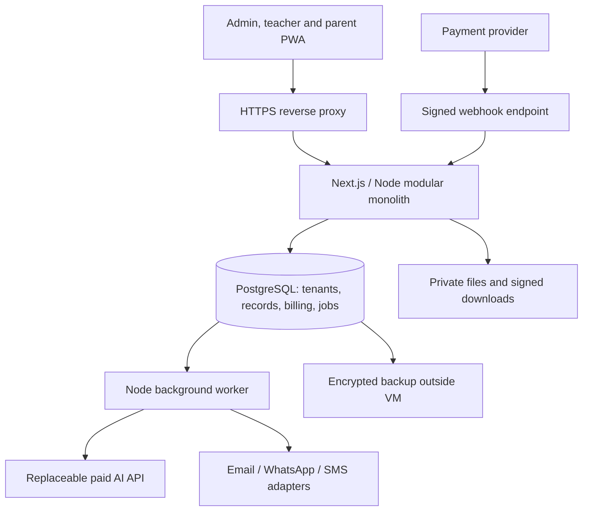

# School management SaaS for India: research and development blueprint

> Scope update, 14 October 2026: the product now includes full procurement/accounting, integrated inventory/library, React with a Node.js backend, and event galleries with expiring parent-download links. The current design is in [Integrated backend blueprint](../architecture/integrated-school-backend-blueprint.md), with [parent/child feature research](parent-and-child-feature-research.md). The original core-only scope, deferred inventory/library list and 10–12-week estimate below are superseded for the expanded product.

Prepared 14 October 2026. Scope: India only; experienced developer; bootstrapped until revenue. The initial segment of independent private schools with 200–1,000 students is a recommendation, not a segment you have confirmed. Budget illustrations use ₹90/USD as a planning assumption, not a current exchange-rate quote. Prices can change; taxes, negotiated rates and provider eligibility must be checked at purchase.

## Decision

Build a **TypeScript application using Next.js, Node.js and PostgreSQL**. Start with a mobile-friendly web app/PWA, a modular monolith and a PostgreSQL-backed background worker. For a live pilot, use one 2 GB Linux server in Mumbai, with encrypted backups outside that server. Keep AI and messaging behind replaceable provider adapters.

Launch a focused subscription product: student records, attendance, a fee ledger, parent notices, syllabus tracking and teacher-approved AI planning. Start collecting school subscription revenue before developing an open-ended student tutor. Build online school-fee collection only when a pilot requires it; school subscription billing and parents paying school fees are separate flows.

For demos and customer validation, hosting can be almost free. For live student records, set a provisional **₹1,500–₹2,500/month platform budget at light pilot usage**, including a small AI allowance and basic backups, excluding bulk messaging, staff time and acquisition. This is an operating estimate, not a capacity or uptime guarantee.

## What the market evidence says

### Demand exists, but national market size is not your reachable market

India's UDISE+ 2024–25 report describes approximately **14.71 lakh schools and 24.69 crore students**. This includes government and other schools that a new private-school SaaS will not immediately sell to. Do not multiply all schools by your subscription price and present that as a credible revenue forecast. [Ministry of Education, UDISE+ report](https://www.education.gov.in/sites/upload_files/mhrd/files/statistics-new/UDISE%2BReport%202024-25%20-%20NEP%20Structure.pdf).

Use a local, bottom-up estimate instead: list 100 independent private schools you can actually reach in one district, identify the 30 with suitable size and a reachable decision-maker, and aim for 3 paid pilots. These are execution targets, not conversion-rate research. At ₹2,499 per school/month, 3 customers mean ₹7,497 MRR; 10 mean ₹24,990 MRR; 30 mean ₹74,970 MRR, before discounts and tax.

### Competitors and substitutes

- **Fedena:** broad ERP with core administration and paid module tiers. The official page retrieved displayed Standard $999, Premium $1,399 and Ultimate $1,699, billed yearly, plus a sales-led enterprise option. This is a USD page observation; an India quote and web/mobile inclusions need separate verification. [Official pricing](https://fedena.com/pricing-and-plans).
- **Teachmint:** integrated student information, fee management, admissions, assessments and parent communication. The page reviewed leads to a demo rather than a published numeric price. Treat pricing as unverified until quoted. [Official ERP overview](https://www.teachmint.com/en-us/features/school-erp).
- **Entab One/CampusCare:** a broad suite, dedicated apps, migration/support and school-size-based custom pricing. This competes on breadth and institutional trust. Its adoption figures are vendor claims, not independently verified market shares. [Official product and pricing description](https://www.entab.in/entab-one.html).
- **MyClassboard:** management and communication suite with WhatsApp and AI-powered question-paper functionality. This demonstrates that AI alone is already a weak differentiator. No numeric price was verified from the reviewed page. [Official ERP page](https://www.myclassboard.com/erp/).
- **Bexra:** publicly advertises ₹5/student/month, while plan sections also invite custom quotes. Use it as evidence of low-price competition; confirm messaging, onboarding, taxes and scope in a written quote before an exact comparison. At the headline rate, 500 students imply ₹2,500/month. [Official site](https://www.bexratech.com/).
- **Frappe Education:** an existing open-source route with student/teacher records, admission, fees and scheduling. Its repository declares GPL v3; hosting and maintenance still cost money. Evaluate licensing before distributing modified software. [Repository](https://github.com/frappe/education), [license declaration](https://github.com/frappe/education/blob/develop/license.txt).
- **The manual substitute:** spreadsheets, paper and existing WhatsApp groups. Its importance for your chosen district is a hypothesis to test in interviews, not a measured share of the market.

**Inference:** a small entrant should compete through quick migration, reliable workflows, usable Hindi/regional-language communication and responsive onboarding. A generic promise of “all ERP modules plus AI” puts you directly against established suites and creates too much development and support work.

### Recommended initial customer and positioning

Target owner-led private schools with 200–1,000 students, in one district, using one board and one or two languages. Prefer schools whose owner/principal can approve a pilot directly. Sell a concrete result: **“Plan and track syllabus coverage, maintain attendance and fee records, and keep parents informed from one simple portal.”**

Owner/principal is the buyer; administrator/accountant handles migration and fees; teachers determine daily adoption; parents determine communication reach. Interview all four. Larger chains tend to add procurement, integrations and service expectations; government sales require a different go-to-market process. These are recommended segmentation choices to validate locally.

Before building beyond the foundation, conduct 15–20 conversations across at least 10 schools. Ask:

1. Show me last month's attendance, pending-fee and syllabus reports. How are they produced?
2. Which ERP is used today, what is the total annual bill, and what would justify switching?
3. Who cleans the student/guardian data and who owns the purchase decision?
4. Which parent channel works, and how many messages are sent in a normal week?
5. Which board, languages, academic calendar and report-card formats must be supported?
6. Will you pay ₹2,499/month for the demonstrated scope, plus communication usage?
7. What would stop a paid rollout after a 30-day trial?

Record observed workflows, actual invoices and objections. A positive response to an AI demo is weaker evidence than an owner agreeing to a paid pilot. Obtain three written pilot commitments and permission to use sample/de-identified curriculum documents before investing in the tutor.

## Language, frameworks and database

### Default custom-build stack

- **Language:** TypeScript for frontend, backend and jobs; SQL for data modelling and reports.
- **UI/application:** Next.js and React; responsive PWA first. Use standard HTML/CSS and a small component library rather than maintaining custom native apps initially.
- **Runtime:** supported Node.js LTS, pinned in Docker and CI.
- **Database:** PostgreSQL, a supported stable major pinned across dev/prod. A shared database with tenant isolation keeps the pilot inexpensive.
- **ORM:** Prisma for schema/migrations and routine queries; use explicit SQL where row security, financial reporting or locking requires it. Validate ORM transaction behaviour before implementing tenant context.
- **Authentication:** an established maintained library such as Better Auth after checking current compatibility. Use secure sessions, password recovery, and administrator MFA. Avoid building your own password/session protocol.
- **Jobs:** pg-boss running in a separate Node process from the same repository; use PostgreSQL for the queue initially.
- **Storage:** private object storage; R2 is a cheap candidate where its data-location arrangement is acceptable. For a contractual India-only requirement, use an India-region storage service and budget it separately.
- **Payment adapter:** Razorpay for your school SaaS invoices/checkout; manual annual bank-transfer invoices can precede automated recurring mandates.
- **AI:** typed server-side provider adapter, token metering, spend caps and approved outputs. No inference GPU in the initial infrastructure.

Next.js supports self-hosting. pg-boss provides a Node/PostgreSQL job queue, so a separate Redis service is unnecessary for the first version. [Next.js self-hosting](https://nextjs.org/docs/app/guides/self-hosting), [pg-boss repository](https://github.com/timgit/pg-boss).

Why TypeScript: one language across the product, shared validation types and straightforward API integration. AI features are API calls and workflows; the core ERP does not need Python just because it uses AI. PostgreSQL fits school/class/student/guardian relationships and transactional payment records, and can later hold vector embeddings alongside ordinary data.

### When a different choice is better

If you already work much faster in **Python/Django**, use Django + PostgreSQL with a responsive frontend. If your strongest existing stack is **PHP/Laravel**, that is also a sensible monolith. Existing skill can outweigh a theoretical framework advantage. Java/.NET can work well, but add no special advantage for this proposed solo pilot if they are unfamiliar.

Evaluate **Frappe Education for 2–3 days before committing to a custom ERP**. If most of the paid-pilot requirements work without deep forks, selling deployment/customisation could reach revenue sooner. It brings a Python/JavaScript framework and its existing operational model, so treat it as a separate product strategy rather than copying its modules into a TypeScript application. Choose custom development when the distinctive planning/communication experience is central and you can own its maintenance.

Avoid a document database as the primary financial/academic database for this product. Avoid changing frameworks after revenue merely for scale: this stack can remain useful while its deployment grows.

## Initial architecture



The reverse proxy, application, worker and PostgreSQL initially share one VM. Storage, delivery and AI are external APIs. The worker is a separate process, not a separate microservice with an independent codebase. Give all processes memory limits; build release images outside the small production VM.

Suggested repository structure:

```text
src/app/                 pages and authenticated route handlers
src/modules/tenancy/     school context and permission checks
src/modules/students/    admissions, enrolments, guardians
src/modules/attendance/  marking, corrections and reports
src/modules/fees/        invoices, receipts, reconciliation
src/modules/curriculum/  source documents and approved plans
src/modules/messaging/   campaigns, consent and delivery attempts
src/modules/billing/     your SaaS plans and subscription state
src/modules/ai/          provider adapter, quotas and evaluation
src/jobs/                worker entrypoint and job handlers
prisma/                  migrations and schema
ops/                     Docker Compose, backup and restore runbooks
```

Routes should perform validation and authorisation then call module services. Keep business rules independent of pages and provider SDKs. Reuse those services if a native app is added later.

### Multi-tenancy and permissions are foundational

One school is one tenant. Put `school_id` on every school-owned record and use tenant-scoped unique keys and composite foreign keys. Derive the current school from the authenticated user's membership; never trust a request-body school ID alone. A subdomain is a routing convenience, not authorisation.

Use PostgreSQL row-level security as defence in depth, plus application checks. The runtime database role must not be a superuser, table owner with unrestricted bypass, or `BYPASSRLS` role. Set tenant context transaction-locally and clear it by ending the transaction, including in background jobs. The migration role is separate. RLS does not decide which child a parent may see or which class a teacher may edit; add those resource permissions. [PostgreSQL row security](https://www.postgresql.org/docs/current/ddl-rowsecurity.html).

Scope every export, cache entry, file download, job and AI retrieval by tenant. Check guardian/student links for parent access and class/subject assignments for teacher access. Platform administration should use a separate explicit support path with audited, time-limited school access.

### Database blueprint

Use UUID identifiers; store timestamps in UTC and render school-local dates in Asia/Kolkata. Store attendance day as a school-local `date`. Keep money in integer paise or exact decimal types, never floating-point arithmetic.

- `schools`, `users`, `school_memberships`: tenant and role mapping, with one user able to belong to multiple schools.
- `academic_years`, `classes`, `sections`, `subjects`: school-specific structure and calendar.
- `students`, `guardians`, `student_guardians`, `enrolments`: stable student identity, verified access links and year-by-year class history. Do not overwrite previous-year enrolment on promotion.
- `teacher_assignments`, `attendance`, `attendance_changes`: allowed teaching scope, unique daily attendance and corrections.
- `fee_schedules`, `student_invoices`, `invoice_lines`, `payments`, `payment_allocations`, `refunds`: school fee records. Preserve issued receipts; reverse/correct with recorded entries rather than silently deleting payments.
- `announcements`, `recipient_snapshots`, `delivery_attempts`: approved content, intended audience, channel, provider IDs and delivery outcomes.
- `curriculum_documents`, `topics`, `plan_versions`, `scheduled_lessons`, `coverage_updates`: source/version references and actual syllabus progress.
- `saas_plans`, `school_subscriptions`, `saas_invoices`, `billing_events`: your revenue and feature entitlements, separate from student fees.
- `ai_usage`, `consent_records`, `audit_events`: metered usage, notices/consent history and administrative actions.

Important constraints: unique `(school_id, student_id, attendance_date)` for daily attendance; unique tenant-specific admission number; same-tenant foreign keys between enrolments/classes/students; unique provider event ID for webhook deduplication. Add indexes beginning with `school_id` for frequent attendance-date, student, invoice-status and class lookups. Use typed columns for core records; JSONB is suitable for flexible AI output and metadata.

## Subscription design and first price experiments

The school pays your subscription. Parents should not need to buy a subscription simply to receive school notices.

Proposed launch pricing, **hypotheses to test**, exclusive of applicable tax:

- **Core:** ₹2,499/school/month up to 500 active students; ₹3,999 up to 1,000. Include records, attendance, fee ledger, parent portal, syllabus tracking and ordinary exports.
- **AI planning add-on:** test ₹999/school/month with a clearly disclosed workload allowance, such as 50 plan generations and 2,000 short drafts. Enforce input/output limits and a monetary ceiling; use actual measured cost to tune the allowance.
- **Communication:** prepaid usage or the school's own messaging account. Show delivered-message costs, provider fees and tax before approving a bulk send. Publish rate changes transparently.
- **Onboarding:** test ₹2,000–₹5,000 once for migration/training; waive only for a limited pilot with an agreed scope.
- **Annual option:** approximately ten months' monthly price for a year's subscription, if cash collection and retention support it. Offer monthly during validation.

Avoid lifetime pricing or unlimited AI/WhatsApp. A subscription can exist without an automatic debit: invoice monthly/annually and activate after reconciliation, then add mandates when customers want them.

For online checkout, Razorpay's standard domestic gateway rate is published as 2% plus GST; its recurring subscription product can add 0.99% plus applicable taxes. Temporary promotional waivers should not drive the business model. [Official fee explanation](https://razorpay.com/blog/razorpay-payment-gateway-pricing-explained/).

Maintain a state machine: trial → active → past_due/grace → restricted → cancelled. Billing webhooks must verify signatures over raw payloads, deduplicate events, and tolerate retries/out-of-order delivery. Reconcile provider state periodically. Give schools an export/read-only grace policy instead of instantly erasing access to records after a payment failure. Check entitlements on the server, including in jobs.

Student fee collection, when added, should settle to each school's authorised merchant arrangement. Do not casually collect every school's tuition into your SaaS company's bank account. Refunds, settlements and receipts then need their own reconciliation workflow.

## AI roadmap and cost controls

### First: syllabus distribution means an approved calendar plan

Working interpretation: distribute curriculum topics across available teaching periods. If you meant just delivering PDFs to classes, ordinary file assignment and notices solve that with much less work.

Workflow: upload authorised syllabus → extract/version text → teacher confirms topics and lesson durations → supply academic calendar, holidays, periods/week, exam dates and revision time → generate proposed explanations/lesson breakdown → deterministic scheduling → validate coverage and constraints → teacher edits/approves → publish → record actual progress.

The scheduler, not an LLM, should guarantee that holidays are skipped, topics fit available slots, dependencies are respected and revision time is reserved. When capacity is insufficient, report the shortfall rather than inventing extra school days. Generate once per class/subject/version and share the approved plan; do not generate the same plan per student. Start with an editable syllabus form and text PDFs; postpone scanned-document OCR until there is demonstrated need.

### Second: draft parent messages; send verified facts

Use deterministic templates for absence alerts, fee amounts, payment receipts and exam dates. AI may draft tone or translate general notices. Keep names, dates and amounts as verified template fields rather than asking the model to invent them. Require recipient preview and staff approval for a new campaign. Add quiet hours, opt-in/preferences, failed-delivery reporting and idempotent retries.

Meta publishes message-based rates varying by category and destination. Its public overview and reports of newer rate-card changes were inconsistent during this research, and the developer rate-card endpoint returned a rate-limit error. Therefore **no exact current India WhatsApp rate is claimed here**. Use the approved live provider quote in billing. Cost examples below use editable assumptions. [Official WhatsApp pricing overview](https://whatsappbusiness.com/products/platform-pricing/).

For Indian bulk SMS, plan sender/principal-entity, header and content-template registration with the provider under the applicable DLT process. [TRAI sender guidance](https://www.trai.gov.in/advice-to-senders).

### Third: a bounded doubt assistant after retention and revenue

Pilot one subject and grade range with licensed/authorised content. Retrieve only approved material for that school/board/year, return source references, tutor through hints and steps, and offer a teacher handoff when evidence is insufficient. Documents and student inputs are untrusted; they cannot override system permissions. The tutor should have no access to student fee records or unrestricted database tools.

Start with text; add photos/OCR and audio later. Limit sessions and tokens, evaluate correctness and multilingual quality with teachers, and do not promise guaranteed exam answers. Add `pgvector` only when retrieval actually needs embeddings; a separate vector database is unnecessary initially.

### Provider selection needs to account for age and actual model access

For a **separate, access-controlled adult staff tool**, benchmark paid Gemini 3.5 Flash-Lite as an initial candidate. The reviewed listing is $0.30/million input tokens and $2.50/million output tokens. Do not start a new product on 2.5 Flash-Lite solely for its cheaper listed price: Google's deprecation page says 2.5 access is limited to existing users. [Pricing](https://ai.google.dev/gemini-api/docs/pricing), [availability/deprecation notes](https://ai.google.dev/gemini-api/docs/deprecations).

Gemini Developer API terms restrict clients directed at or likely accessed by under-18s; paying does not remove that restriction. A teacher role inside a mixed student application should not be assumed sufficient. Confirm the adult-client arrangement and choose an appropriate contracted provider before a student tutor launches. Paid-service prompts are not used for product improvement under the reviewed terms, but limited safety logging and international processing still matter. [Provider terms](https://ai.google.dev/gemini-api/terms).

The cost model uses the above model's text rates as a benchmark, not approval for student use:

- 5,000 input + 1,500 output tokens: $0.00525 ≈ ₹0.47 per planning call.
- 600 input + 150 output tokens: $0.000555 ≈ ₹0.05 per short draft.
- 2,500 input + 500 output tokens: $0.002 ≈ ₹0.18 per question; 10,000 such questions ≈ ₹1,800.

Those are token arithmetic examples, not observed usage. Multiple calls, thinking tokens, retries, retrieval/embedding, long histories, OCR and audio increase cost. Each tenant needs an atomic spend reservation before a call, an actual-usage reconciliation afterwards, max input/output lengths, a daily cap and a monthly cap. Provider budget alerts alone are not a hard spending stop. Use templates/manual operation when AI is unavailable.

## Cheapest infrastructure options

### Demo and validation: $0 base cost within limits

Use local Docker development, or a lightweight React frontend + Cloudflare Worker API + Neon free PostgreSQL for a hosted demo. This is an alternate deployment profile, not the same full Node worker deployment. Prefer synthetic data. Workers Free lists 100,000 requests/day but only 10 ms CPU per invocation; keep PDF processing and persistent job polling outside that runtime. [Cloudflare pricing](https://developers.cloudflare.com/workers/platform/pricing/).

Neon's retrieved free listing provides 1 GB/project and 100 CU-hours/project/month. Continuous polling can keep compute awake and consume the allowance. Verify cold-start, backup/restore and commercial terms before a real pilot. [Neon pricing](https://neon.com/pricing).

### Live pilot: my default recommendation

- **AWS Lightsail Mumbai Linux/public IPv4, 2 GB:** $12/month. Mumbai is supported. Do not budget a 512 MB VM for Next.js + PostgreSQL + worker. [Price](https://aws.amazon.com/lightsail/pricing/), [regions](https://docs.aws.amazon.com/lightsail/latest/userguide/understanding-regions-and-availability-zones-in-amazon-lightsail.html).
- **Alternative: DigitalOcean Basic 2 GiB:** $12/month published; check Bangalore availability for the selected size. The 1 GiB $6 plan is possible for a lean service but has less headroom. [Pricing](https://www.digitalocean.com/pricing/droplets).
- **Files/backups:** R2 Standard currently includes 10 GB-month storage and specified free operation allowances; Internet egress is free. Paid storage is $0.015/GB-month beyond allowances. Backups share that quota with uploaded documents. Its low bill does not promise Indian data residency. [R2 pricing](https://developers.cloudflare.com/r2/pricing/).
- **Email:** Resend free allows 3,000/month and 100/day. A notice to 500 parents breaches the daily quota. Use it for low-volume transactional/admin email; budget a paid sender before parent email becomes a promised channel. [Email pricing](https://resend.com/pricing).

Pilot planning example: server $12 + backup/storage provision $1 + domain amortisation provision $1 + small AI allowance $5 = **$19/month ≈ ₹1,710 before applicable tax/FX charges**. The $1 items are allowances, not quoted domain or backup plans. Set aside ₹1,500–₹2,500/month; email upgrades and messaging increase that.

Other options: Cloudflare Workers Paid starts at $5 plus usage, but database and Node-runtime/job adaptations still need budgeting. Supabase Pro starts at $25 before app hosting and extra projects/compute; it can save operational time but is not the lowest bill for this VM-based plan. Vercel Hobby is limited to personal/non-commercial usage, so it is not the default host for this paid SaaS. Hetzner can be attractive, but current location-specific checkout prices were not retrievable; do not rely on old European headline prices for an India pilot. [Workers](https://developers.cloudflare.com/workers/platform/pricing/), [Supabase](https://supabase.com/solutions/hosted-postgres), [Vercel terms](https://vercel.com/legal/terms), [Hetzner listing](https://www.hetzner.com/cloud/cost-optimized/).

### Reliability you should include even at this budget

A single VM has one failure domain. Maintain encrypted nightly database backups outside it, upload completion alerts and a tested restore procedure. Pilot targets: recovery point ≤24 hours and recovery time ≤4 hours, verified rather than promised. Take pre-migration backups and keep offsite copies under a separate credential. VM snapshots alone are not a database recovery plan.

Use managed TLS, restricted SSH, private PostgreSQL networking, dependency/security patching, uptime/error alerts and logs that omit student data. Retain audit records and protect exports. Start with light reports and limited worker concurrency. Load-test simultaneous morning attendance submissions, large imports and reports before increasing school count; student count alone is not a capacity estimate.

## Economics: messaging and support matter

For an assumed 500-student school, 22 notifications/student/month means 11,000 deliveries. At an **illustrative, unverified** ₹0.15/delivery, that is ₹1,650/month; at ₹0.90 it is ₹9,900, before provider extras and tax. That can exceed a ₹2,499 subscription. Bundle important updates, use the portal for routine information and sell delivery usage separately. Never label every school notice as utility automatically.

Illustrative monthly operating model for core-only customers: ₹2,499 revenue/school; 2.36% one-time-checkout gateway cost; ₹100 AI usage provision/school; ₹500 support provision/school. Shared infrastructure provision: ₹1,500 for 1–3 schools, ₹2,500 at 10. This yields approximately ₹340 at 1 school, ₹4,020 at 3, and ₹15,900 at 10, after those provisions but **before founder engineering time, acquisition, tax, legal/accounting and other costs**. These are scenario outputs, not profitability forecasts. Automated recurring billing would reduce them further through its additional fee.

Support and implementation are likely larger constraints than token cost at teacher-only volumes. Measure support hours per school and migration time, alongside MRR, renewal and AI spend. Charge for significant customisation instead of promising unlimited support within a low subscription.

## India-specific data and rollout requirements

Build notices, access controls, guardian verification, consent history, retention/export/deletion workflows, incident handling and written school/provider processing arrangements. Minimise student details sent to AI; curriculum planning usually needs no student identity. Avoid ads or behavioural monetisation in child accounts.

DPDP Rules 2025 have phased commencement; several operational rules commence 18 months after Gazette publication. They include parental-consent provisions and limited education-related exceptions. Do not assume an educational-institution exception automatically covers an independent SaaS or all AI activities. Verify the applicable Act notifications and duties at launch with Indian counsel. An India-region database also does not make external AI, messaging and storage India-only. [Official Rules/Gazette](https://www.meity.gov.in/static/uploads/2025/11/53450e6e5dc0bfa85ebd78686cadad39.pdf).

## Suggested 10–12-week paid-pilot plan

This schedule assumes one experienced full-time developer, a narrow scope, prompt school feedback and manual onboarding. A beginner or a broad ERP scope needs longer. Do not treat it as a fixed deadline.

1. **Weeks 1–2 — validate and design:** interviews, paid-pilot commitments, Frappe evaluation, calendar/fee samples, workflow prototype, data dictionary and price tests. Exit: three prospects agree to pilot scope and price; choose custom build or adaptation.
2. **Weeks 3–4 — foundation:** tenants, authentication, roles, academic years/classes, students/guardians, import preview/error report, audited support access. Exit: tenant and guardian isolation tested; one clean sample import.
3. **Weeks 5–6 — useful core:** attendance/corrections, fee ledger/receipts, notices/parent portal, exports and backups. Exit: a teacher and administrator complete daily workflows; restore succeeds.
4. **Weeks 7–8 — subscription and planning:** school billing/entitlements, webhook reconciliation, editable syllabus calendar and teacher-approved AI drafts. Exit: a real paid school invoice; invalid schedule is rejected; AI caps work.
5. **Weeks 9–10 — controlled rollout:** onboard three schools gradually, verify imports with staff, add one paid communication channel only if required. Exit: recover failed jobs and reconcile delivery/fees; no unresolved access or financial defects.
6. **Weeks 11–12 — renewal and improvement:** fix adoption friction, measure usage/support, validate price and document operations. Exit: renewal willingness from at least two pilots and repeatable onboarding. Expand only after evidence of use and payment.

Meaningful release tests: two-school isolation across normal queries/export/files/jobs; guardian access to only linked students; payment signature/duplicate/out-of-order processing; attendance save/retry conflicts; AI budget concurrency; syllabus holiday/capacity validation; backup restore and peak attendance load. An attractive dashboard is not sufficient release evidence.

Defer payroll, full accounting, transport GPS, biometric hardware, inventory, hostel/library, white-label app-store apps, voice/video AI and a fully autonomous tutor unless a paying pilot makes one indispensable.

## Upgrade when measurements justify it

The first revenue should improve recovery and support before adding architecture complexity. Upgrade the VM if sustained memory exceeds roughly 75%, swapping appears or peak CPU/latency degrades. Separate the worker if backlog disrupts interactive requests. Move PostgreSQL to managed hosting when restore time, operational burden or school contracts exceed what you can support. Add point-in-time recovery when a 24-hour data-loss window is unacceptable.

Scale the same monolith horizontally when measured concurrency requires it. Add cache, read replicas or specialised services only for a specific bottleneck. Redis, Kubernetes, Kafka, a GPU server and a separate vector database are not prerequisites for revenue.

Your immediate next action is to choose one district, board and language pair, demonstrate three workflows—attendance, fee ledger and syllabus planning—and secure three paid-pilot commitments. Build the foundation with tenant isolation and backups, then keep AI usage and message delivery explicitly metered.

## Research limits

This is desk research of official product, pricing, technical and government sources; no schools or vendors were contacted, no private quotes obtained and no adoption or language-quality tests performed. Vendor pages describe advertised capabilities, not independently tested performance. Exact WhatsApp rates remained unverified. Proposed customer segment, prices, timetable, cost allowances and conversion targets are clearly labelled recommendations or assumptions. Recheck live prices, provider terms and launch-time legal duties before procurement or rollout.
